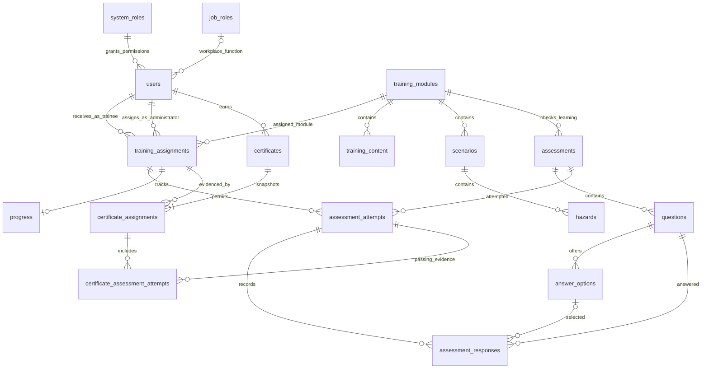

# KISTS database foundation — Phase 2

## Overview

KISTS is a warehousing and logistics safety-training platform developed for the CET257 Enterprise Project. This foundation supports the A7 Manual Handling prototype and later modules; requirements remain subject to client consultation.

PostgreSQL 16 is the local verification target. React, Express, REST and the modular monolith remain unchanged. Future features follow Route → Controller → Service → Repository → PostgreSQL. Tooling reuses `server/src/config/database.ts`; no ORM, additional service or authentication is introduced.

Objects live in the **`kists` schema**. The pool sets `search_path=kists,pg_catalog` and UTC session time. Event timestamps use `timestamptz`; clients may display instants in local time.

## Tables

Domain keys use `integer GENERATED ALWAYS AS IDENTITY`. Integers are sufficient here, readable in SQL exercises and returned by `pg` without bigint conversion. IDs do not carry business meaning. The migration ledger uses the migration filename as a natural key.

| Table                             | Purpose and key constraints                                                                                                |
| --------------------------------- | -------------------------------------------------------------------------------------------------------------------------- |
| `system_roles`                    | Stable permission identifiers: `trainee`, `administrator`.                                                                 |
| `job_roles`                       | Workplace functions, independent of permissions.                                                                           |
| `users`                           | One system role, optional job role, names, unique case-insensitive email, password hash and active state.                  |
| `training_modules`                | Extensible catalogue, unique slug and active state.                                                                        |
| `training_assignments`            | Trainee/module, assigning administrator, due date, required flag, lifecycle (`active`/`cancelled`); unique trainee/module. |
| `training_content`                | Ordered typed content with body and/or resource reference.                                                                 |
| `scenarios`                       | Multiple ordered scenes per module; inactive drafts may lack assets.                                                       |
| `hazards`                         | Ordered decision points, feedback, yaw/pitch in degrees and optional JSON object metadata.                                 |
| `assessments`                     | Multiple per module; configurable pass percentage in `(0,100]`, **without a default**.                                     |
| `questions`                       | Ordered single-choice, true/false or free-text questions.                                                                  |
| `answer_options`                  | Question options, answer key and ordering.                                                                                 |
| `assessment_attempts`             | Attempt number, assignment, assessment, submission, score, threshold snapshot and derived pass result.                     |
| `assessment_responses`            | Unique attempt/question, optional selected option or free text, correctness snapshot.                                      |
| `progress`                        | One aggregate record per assignment; percentage and start/completion/access timestamps.                                    |
| `certificates`                    | Whole-required-training completion evidence, reference, trainee and issuance/revocation state.                             |
| `certificate_assignments`         | Immutable assignment set and completion timestamps at issuance.                                                            |
| `certificate_assessment_attempts` | Passing attempt evidence for each active assessment in that set.                                                           |
| `schema_migrations`               | Tooling ledger: migration filename, SHA-256 checksum, timestamp.                                                           |

There are **17 domain tables plus one migration ledger**. The two certificate supporting tables are necessary because one certificate covers many assignments and assessment results.

## System roles and job roles

A **system role** controls permissions. Only trainees can receive assignments, and only administrators can be recorded as assigning them. A **job role** describes workplace function; Warehouse Operative, Forklift Operator and Supervisor are example values, not permission roles.

Modelling choice: trainees may temporarily have no job role while awaiting allocation; administrators do not carry trainee job roles. Foreign keys reject nonexistent roles. Triggers reject assignment role mismatches, permission-identifier renames and system-role changes for users with training history. This restriction is explicit, not a claim of an additional confirmed client rule.

Job-role-based assignment automation is not implemented. A future job-role requirement mapping can be added once policy is confirmed, without changing the trainee/module relationship.

## Major relationships / ERD



## Integrity, normalization and retention

- Composite foreign keys keep progress/attempts attached to the same assignment, trainee and module. A response must use a question in the attempted assessment and an option belonging to that question. Certificate attempt evidence must match the snapshotted assignment and assessment.
- Repeated relationship columns exist only where needed for these enforceable composite keys; they cannot diverge independently.
- `lower(email)` uniqueness prevents case-based duplicate accounts. Checks reject empty names, invalid slugs, bad sequence numbers, percentages, hotspot coordinates and contradictory submission/completion states.
- Progress at 100% requires a completion timestamp; other percentages forbid one. Progress means aggregate **learning completion**, with assessment passing checked separately.
- Assignment status tracks lifecycle only; completion is not duplicated there. One assignment per trainee/module includes cancelled rows. Re-enable that row for the same assignment. Recertification cycles would need a future explicit period model.
- Submitted attempts and their responses are immutable. Thresholds are snapshotted at attempt creation; `passed` is generated from score and the snapshot, so later configuration changes do not rewrite results.
- Aggregate progress and final scores are stored because detailed interaction events/grading are outside Phase 2. Response correctness, thresholds and completion snapshots preserve history. Future services must compute/validate results: the database is **not a grading engine**.
- Exactly-one-correct-option authoring rules, content versioning, attempt limits and multiple selections require later validated feature work. The current response model supports one selected option or free text, not a multi-selection question.
- Referenced users, roles, modules, assignments and historical records use `ON DELETE RESTRICT`; deactivate/archive them. Limited cascades apply to scenario → hazards, assessment → questions, question → answer options and draft attempt → responses. Referenced questions/options and submitted attempts cannot be deleted.
- Foreign-key/query indexes cover module assignments, assigning users, active due dates, module progress, attempts, responses and evidence. Unique parent/sequence and trainee/module indexes also cover their leading columns.
- Mutable tables get automatic `updated_at` timestamps. Resource references reserve future assets; no panorama viewer or VR is included.

## Certification: all required assigned training

### Eligibility

`kists.certification_eligibility` returns current eligibility for active trainees. Requirements are:

1. At least one **active required assignment**; zero assignments does not earn a certificate.
2. Completed learning progress for every such assignment.
3. At least one submitted passing attempt for **every active assessment** associated with those assigned modules.

Optional assignments, cancelled assignments, unassigned modules and inactive draft assessments do not block eligibility. Deactivating a module does not waive an existing required assignment. A module with no active assessment has no assessment condition; later publishing validation must decide whether such a module can be released. All active assessments are treated as required within a required module; optional assessment policy is not invented.

### Issuance and availability

Inserting a certificate checks eligibility and records actual issuance time. The same transaction automatically snapshots all required assignments and the latest passing attempt for each active assessment. Direct evidence insertion or rewriting is rejected.

Issuance briefly takes PostgreSQL SHARE locks on eligibility input tables, preventing concurrent requirement/result changes mid-issuance. This simple foundation choice blocks eligibility-changing writes during issuance. A later service should use a short, dedicated READ COMMITTED transaction and handle normal deadlock/serialization retries; larger-scale use may need finer locks. Integrity triggers do not replace API authorization or restricted database accounts.

Modelling default: at most one `issued` certificate per trainee. Revoke it with a timestamp before replacement. Revocation is one-way and preserves evidence. No expiry/renewal schedule is claimed as client policy.

**`kists.available_certificates` is the future current-certificate read source.** It requires current eligibility and evidence covering every current required assignment and active assessment. Adding new requirements removes an outdated certificate from this view. Completing those new requirements does not retrospectively expand the old evidence: revoke/reissue when appropriate. The old certificate remains a historical record.

No certificate document, generation endpoint or download interface has been implemented.

## Training extensibility

Manual Handling and Forklift and Pedestrian Safety are catalogue rows. Additional modules use the same content, scenario, hazard, assessment and assignment tables; no per-topic tables or redesign are needed. Manual Handling remains the main planned A7 demonstration module.

## Configure local PostgreSQL

Use Node.js 22.12+ and local PostgreSQL 16. For an existing installation, create an empty **`kists_dev`** database with your local owner and put its URL in ignored `server/.env`. Preserve `PORT` and `CLIENT_URL`. The role needs schema/table/function creation rights. These development privileges are not a deployment policy.

Alternatively, with PostgreSQL 16 installed on Windows, run from the repository root:

```powershell
powershell.exe -NoProfile -ExecutionPolicy Bypass -File database/scripts/start-local-postgres.ps1
```

This creates/restarts a separate loopback-only cluster in ignored `.local/postgres/data`, port **55432**, database **`kists_dev`**. It generates a random password and stores the URL only in ignored `server/.env`. It does not alter the existing PostgreSQL service or the machine's execution policy. Initial setup refuses to replace a custom URL.

Use `-PostgresBin 'C:\path\to\PostgreSQL\bin'` or `-Port 55433` if needed, and reuse that port on subsequent starts. The cluster is not a Windows service; rerun the script after a reboot. Preserve `.local` to retain its data.

To stop the project-owned cluster:

```powershell
& 'C:\Program Files\PostgreSQL\16\bin\pg_ctl.exe' -D "$PWD/.local/postgres/data" -m fast -w stop
```

## Migrations

From the root (use `npm.cmd` if PowerShell blocks `npm.ps1`):

```sh
npm ci
npm run db:migrate
npm run db:check --workspace server
```

The runner locks migration execution, validates ordered `NNN_description.sql` filenames, creates the schema/ledger, verifies applied order and checksums, and applies pending files in a single transaction. Failure rolls back the batch. Repeated execution is a no-op. SHA-256 checksums normalize CRLF/LF so Git line endings do not cause false changes.

Add a **new numbered migration** rather than editing applied files or manually changing checksums. There are no automatic down migrations; reset is an explicit development operation. Migrations do not seed accounts or thresholds. Compiled tooling still needs the repository's `database` directory; file paths are resolved relative to the module, not the shell working directory.

## Development seed

```sh
npm run db:seed
```

Run migrations first. Seeding is transactional and repeatable, preserves existing rows using natural keys, and is restricted to loopback hosts and names `kists_dev`/`kists_test` (optional underscore suffix) outside `NODE_ENV=production`.

Fixtures include:

- Two system roles, three example job roles and the two initial training modules.
- Explicit **DEMO** content, an inactive scenario/hazard, an inactive assessment, one sample question and two options.
- An arbitrary **75% demo-only threshold**, not a client-confirmed requirement or database default.
- Disabled fictional accounts `demo.administrator@example.invalid` and `demo.trainee@example.invalid`.
- A required Manual Handling assignment, optional Forklift and Pedestrian Safety assignment and zero progress. Assignment optionality is illustrative, not client policy.

Demo users receive salted scrypt hashes of random discarded values. There is no usable demo password or authentication flow. Seed preserves existing hashes and refuses reserved emails if they identify active/non-demo users. No completed attempts or certificates are seeded.

## Development reset

```sh
npm run db:reset -- --confirm=kists_dev
npm run db:seed
```

The confirmation must match the configured development database name. Without it the command refuses to act. Reset rejects remote/unrelated databases and production mode.

Reset drops **only `kists` and objects depending on it**, then reapplies migrations atomically. It never drops the database or resets `public`, but it erases KISTS records. Use disposable development data and stop application writers first. Seeding is separate.

## Tests

```sh
npm run test:db
npm test
npm run typecheck
npm run lint
npm run format:check
npm run build
```

Database tests use the configured local `DATABASE_URL`, create independent `kists_test_<random>` schemas, apply actual migrations/seeds and clean up only those schemas. Each test rolls back its fixture changes. They require schema creation rights and fail instead of silently skipping when PostgreSQL is unavailable. API tests remain database-independent. Typechecking includes test files.

Coverage includes migration replay/checksums, seed repeatability, role relationships, duplicates, multiple scenes/assessments, cross-entity response integrity, result snapshots, certificate eligibility/evidence and local-target restrictions.

## References

Foreign keys and cross-row integrity follow PostgreSQL's [constraint documentation](https://www.postgresql.org/docs/16/ddl-constraints.html). Issuance uses the table-lock semantics in [explicit locking](https://www.postgresql.org/docs/16/explicit-locking.html).
